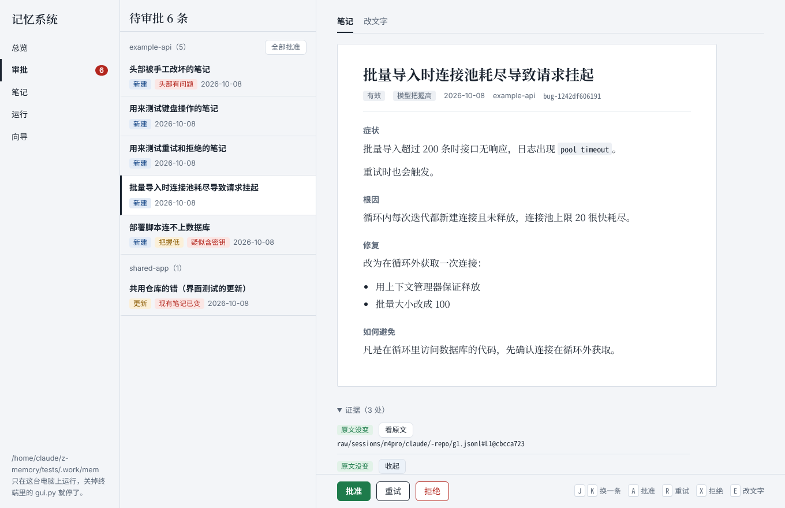
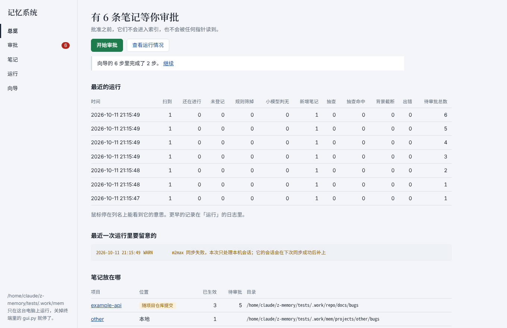

# z-memory

把和 Claude Code 的编程会话沉淀成本地、可读、要经过人审批的 bug 复盘笔记，让同一个 bug 不犯第二次。

每晚自动提炼，第二天早上由你批准，批准过的笔记才会被 agent 读到。纯 Python 标准库，不装任何依赖，所有数据留在你自己的电脑上。



## 它做什么

1. **同步**：每晚把本机（和另一台 Mac）的 Claude Code 会话镜像到 `~/memory/raw/`。
2. **粗筛**：先用规则去掉明显无关的会话，再让小模型判断有没有值得记的 bug。
3. **提炼**：强模型在项目目录里只读运行，写出症状、根因、修复、如何避免，并给出证据行号。
4. **审批**：笔记先进待审批区。你逐条批准、拒绝或要求重试，批准的才进入索引。
5. **使用**：配置文件里的几行指针让 agent 在遇到报错时先查索引，命中了再读正文。

模型只负责语义（标题、关键词、正文），编号、日期、来源、文件名、索引这些事实字段全部由代码生成。设计上的取舍见 [docs/design.md](docs/design.md)。

## 这个仓库只放代码

| | 放什么 | 在哪 | 能不能推到托管平台 |
| --- | --- | --- | --- |
| **z-memory**（这个仓库） | 脚本、界面、提示词、测试、文档 | 随便克隆到哪 | 可以，里面没有任何个人数据 |
| **memory**（你的数据） | 原始会话、笔记、台账、注册表 | `~/memory` | **不要**。原始会话和笔记都没有脱敏 |

`~/memory` 自己也是一个 git 仓库，但只在本机用来管版本。它的 `.gitignore`（[templates/memory.gitignore](templates/memory.gitignore)）把 `raw/`、`_state/` 和待审批的笔记排除在版本库之外。

## 快速开始

需要：macOS，Python 3.7 以上（系统自带的就行），`git`，`rsync`，已经登录的 [Claude Code](https://claude.com/claude-code) 命令行。

```bash
git clone https://github.com/cryanskl/z-memory.git
python3 z-memory/scripts/gui.py
```

浏览器会打开 `http://127.0.0.1:8765/`。进「向导」，按顺序做：

1. **建仓库**：点「补上缺的目录和文件」。它会建好 `~/memory`，写好 `.gitignore`，把脚本和提示词复制到 `~/memory/scripts/`。之后改用 `python3 ~/memory/scripts/gui.py` 启动。
2. **登记项目**：先只登记一个最近在写的项目。没登记的目录不会被处理。
3. **验证清洗**：挑一段你记得内容的会话，看「我的发言轮数」和实际是否相符。这一步不过，后面都不用做。
4. **试提炼**：把起始时间往回拨，手动跑一次，看提炼出来的笔记你自己愿不愿意读。
5. **定时运行**：生成 launchd 配置。先连续观察 3 到 5 天，每天早上审批。
6. **加指针**：笔记质量稳定之后，再让 agent 读它们。

`~/memory` 不在默认位置时，启动前设置环境变量 `MEMORY_DIR`。

## 图形界面



| 页面 | 能做什么 |
| --- | --- |
| 总览 | 多少条等审批，最近几次运行的汇总和告警，每个项目的笔记放在哪 |
| 审批 | 看正文、和现有笔记的差异、证据对应的会话原文；直接改文字；批准、重试、拒绝 |
| 笔记 | 按位置和状态筛选，搜标题、关键词、正文或编号；引用可以点过去 |
| 运行 | 手动跑一次每晚脚本并看日志；核对证据和引用、重建索引、按编号查找；查看台账 |
| 向导 | 上面的六步 |

审批页的键盘操作：`J` `K` 换条，`A` 批准，`R` 重试，`X` 拒绝（后两个要按两次），`E` 改文字。

界面只监听 `127.0.0.1`。每次启动生成一个随机令牌写在页面里，所有请求都要带上它，请求的 Host 和 Origin 也要对得上，所以浏览器里的其他网页读不到也改不了任何东西。页面不加载任何外部资源。

界面有三件事不替你做，因为它们会影响界面之外的地方：不执行 `git commit`，不加载 launchd（只写配置文件并给出命令），不改 `~/.claude/CLAUDE.md`（只给出指针让你复制）。

## 命令行

界面和命令行调用同一套函数、拿同一把锁，可以混着用。

```bash
python3 ~/memory/scripts/nightly.py          # 每晚任务，平时由 launchd 触发
python3 ~/memory/scripts/review.py list      # 列出待审批的笔记
```

| 命令 | 作用 |
| --- | --- |
| `review.py list` | 列出待审批的笔记，标出新建还是更新、模型的把握、现有笔记是否已变、是否疑似含密钥 |
| `review.py show <项目> <文件>` | 查看一条。如果是更新，显示它和现有笔记的差异 |
| `review.py approve <项目> <文件>` | 批准：扫描密钥，检查头部，核对现有笔记有没有被改过，写入并重建索引 |
| `review.py reject <项目> <文件>` | 拒绝：这个问题不值得记。删除，以后不再生成 |
| `review.py retry <项目> <文件>` | 重试：值得记，但这次写得不好。下一晚重新提炼这一条 |
| `review.py reindex` | 手工改过笔记之后，重建所有索引 |
| `review.py verify` | 核对所有笔记的证据和相互引用 |
| `review.py find <id>` | 按编号找一条笔记 |
| `review.py pointers` | 按注册表生成要贴进用户级配置的指针 |
| `review.py newid` | 生成一个新编号，手工新建或晋升笔记时用 |

`approve`、`reject`、`retry` 可以用 `--all` 代替文件名。`approve` 扫到密钥时不写入，确认是误报后加 `--force`；现有笔记在提炼之后被改过时也不写入，合并好之后加 `--overwrite`。

## 验证清洗

清洗函数把会话文件压成模型能读的文字。它是照着一个云端环境里的会话文件写的，**还没有在真实的本机会话上验证过**。第一次运行前，在你自己的会话上跑一遍（界面的向导里有同样的一步）：

```bash
cd ~/memory/scripts
python3 - ~/.claude/projects/<目录>/<会话>.jsonl << 'EOF'
import sys, nightly
lines = open(sys.argv[1], encoding="utf-8", errors="replace").read().splitlines()
cwd, background, new, stats, dates = nightly.clean_session(lines)
print("工作目录:", cwd)
print("统计:", stats)
print("日期:", sorted(set(dates.values())))
print(new[:3000])
EOF
```

看四点：工作目录是不是项目路径；`user_turns` 和你实际发言的轮数是否大致相符；报错的工具结果有没有标成「含报错」；`branch` 是不是当时所在的分支。

## 配置

改 `~/memory/scripts/nightly.py` 开头的常量：

| 常量 | 默认值 | 含义 |
| --- | --- | --- |
| `TRIAGE_MODEL` / `DISTILL_MODEL` | `haiku` / `sonnet` | 粗筛和提炼用的模型，Claude Code 的模型别名 |
| `M2_HOST` | `m2max` | 另一台 Mac 在 `~/.ssh/config` 里的主机名。连不上时只处理本机 |
| `FIRST_RUN_DAYS` | 1 | 首次运行时往回处理几天的会话 |
| `SETTLE_HOURS` | 24 | 会话超过这么久没有改动，才认为已经结束 |
| `MIN_USER_TURNS` | 3 | 整段会话里你的发言少于这个数，不值得提炼 |
| `AUDIT_SAMPLE` | 2 | 每晚抽几段被规则筛掉的会话，交给小模型复核 |

两份提示词在 `~/memory/scripts/prompts/`，改提示词不用动脚本。

## 更新脚本

向导只复制缺少的文件，不会覆盖已有的。拉取新版本之后自己复制过去；提示词如果你调过，不要覆盖：

```bash
cd z-memory && git pull
cp scripts/*.py scripts/gui.html ~/memory/scripts/
```

## 仓库结构

```text
scripts/
  memlib.py        公共部分：注册表、笔记头部、索引、证据指纹、密钥扫描、锁和台账
  nightly.py       每晚任务：同步、清洗、粗筛、抽查、提炼，把笔记放进待审批区
  review.py        审批命令
  gui.py           图形界面的本地服务
  gui.html         图形界面的页面
  prompts/         粗筛和提炼的提示词
templates/
  memory.gitignore                  ~/memory 的 .gitignore
  com.zenith.memory-nightly.plist   launchd 配置的样例
  pointers.md                       三段指针
tests/             全流程测试和界面测试
docs/design.md     设计文档
```

## 测试

```bash
./tests/run_tests.sh        # 全流程，93 项。需要 bash、git、rsync、perl
./tests/gui_run_tests.sh    # 界面，98 项。另外需要 pip install playwright 和 Chromium
```

测试用模拟的会话文件和一个假的 `claude` 命令（`tests/bin/claude`），在 `tests/.work/` 下用独立的家目录运行，不会碰你真实的 `~/memory` 和 `~/.claude`。

## 现状与限制

- **没有接过真实模型。** 两套测试都用假的 `claude` 命令，提炼质量要靠试提炼来看。
- **没有在 macOS 上跑过。** 测试只在 Linux 上跑过；launchd 配置只验证了能生成，没有实际加载过。界面只在 Chromium 里测过。
- **只覆盖 Claude Code。** Codex 的会话格式不同，还没有对应的清洗函数。网页端对话的每周导入、每月迭代和 skill 候选目前只有设计。
- **保留改写前的会话版本依赖 rsync 的 `--backup-dir`。** 新版 macOS 自带的 rsync 不一定支持，不支持时照常同步，日志里记一行 WARN。
- **本地笔记只在一台电脑上查得到。** 要在另一台上用，得把 `~/memory` 克隆过去并加同样的指针。
- **`~/memory/raw/` 没有任何备份。** 它不进版本库，又可能是会话的唯一副本。
- **密钥扫描不是脱敏。** 它只认常见的密钥格式，客户名称、内部地址这类信息要靠审批时自己看。原始会话会随提炼请求发送给云端模型。

## 许可证

[MIT](LICENSE)
